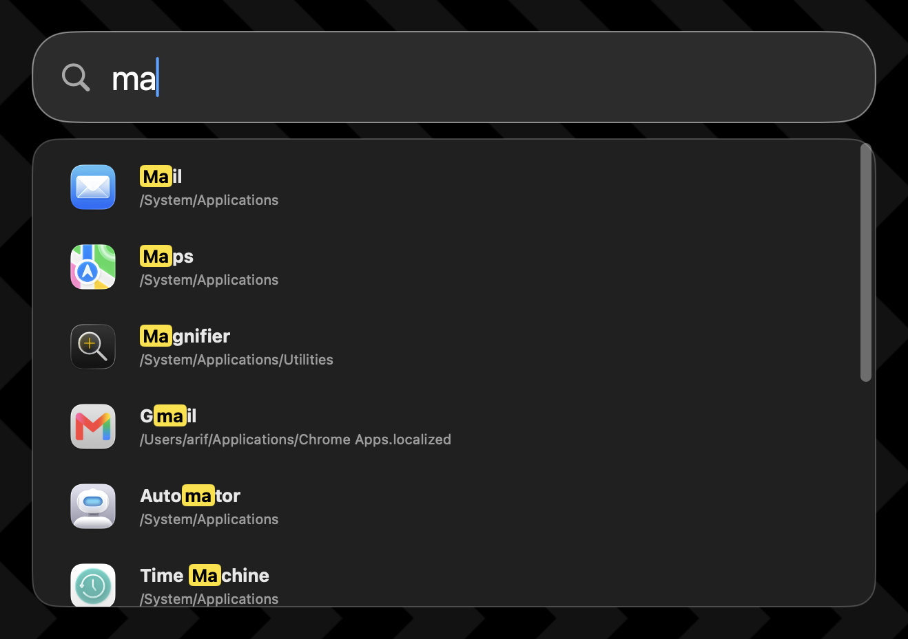

# Launcher (aka Spotlite)



Launcher (aka Spotlite) is a lightweight macOS app launcher (Spotlight clone).
Press **⌘ Space**, type an app name, then choose a result to open it. Search
results update as you type, and you can navigate choices with the keyboard.

## Why I built it

I noticed Spotlight indexing using a lot of my CPU for background tasks I did
not ask it to perform. As a developer, I create many files and build artifacts,
and I don't use Spotlight to search file contents. The only feature I
occasionally needed is quickly opening an application.

The alternatives I looked at often brought along a web view, Node.js, or
Electron, and some used hundreds of megabytes of memory while idle. Even Tinycast
boasts at consuming 100MB of RAM while idle! I only needed to search a small set
of known application directories and launch an app every now and then. So I
built Launcher with native macOS technologies to do just that.

This app does no background work, is performant and consumes around 22MB RAM
when idle, (and no application icons loaded into memory)

## Architecture

- **LauncherApp**: app startup, global shortcuts, panel lifecycle, and routing
  panel-level events.
- **LauncherGUI**: views, state and actions that directly manipulate the GUI.
- **LauncherCore**: core types and domain logic.

## Usage

Launcher requires macOS 14 or later and a Swift 6 toolchain. This package
produces a self-contained executable, not a complete `.app` bundle.

```sh
swift build --configuration release --product launcher
```

The executable is created at `.build/release/launcher`. Run it directly:

```sh
./.build/release/launcher
```

Launcher does not change Spotlight settings or install itself to start at
login. If you want to stop Spotlight indexing, configure that separately in
macOS. Disabling indexing and freeing **⌘ Space** are separate settings: change
or disable Spotlight's keyboard shortcut if it currently owns that combination.
Once Launcher is running, **⌘ Space** opens its search panel.

## Profiling

Memory:

```sh
pid=$(pgrep -x launcher) && footprint -p "$pid"
```

CPU:

```sh
sample "$(pgrep -x launcher)" 5 1 -file /tmp/launcher.sample
```
